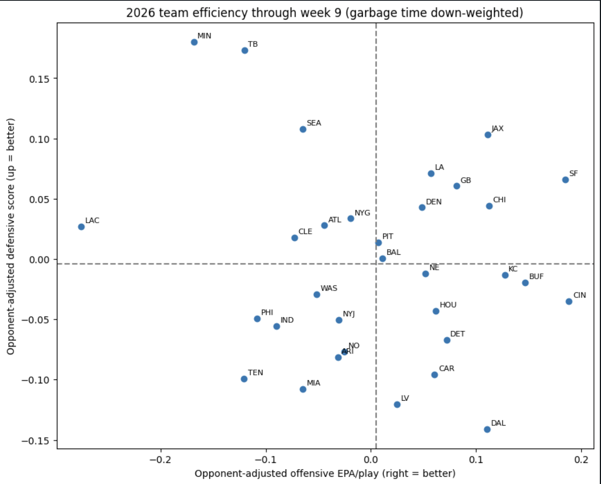
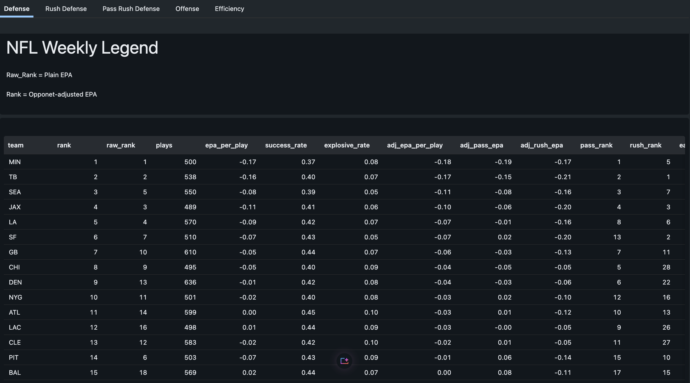
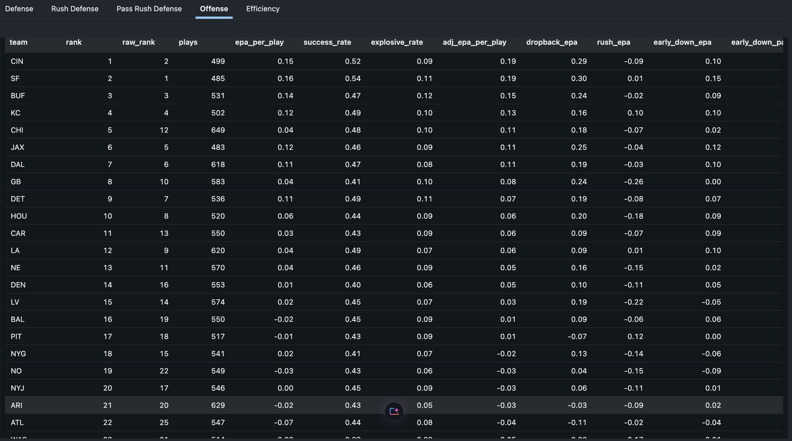
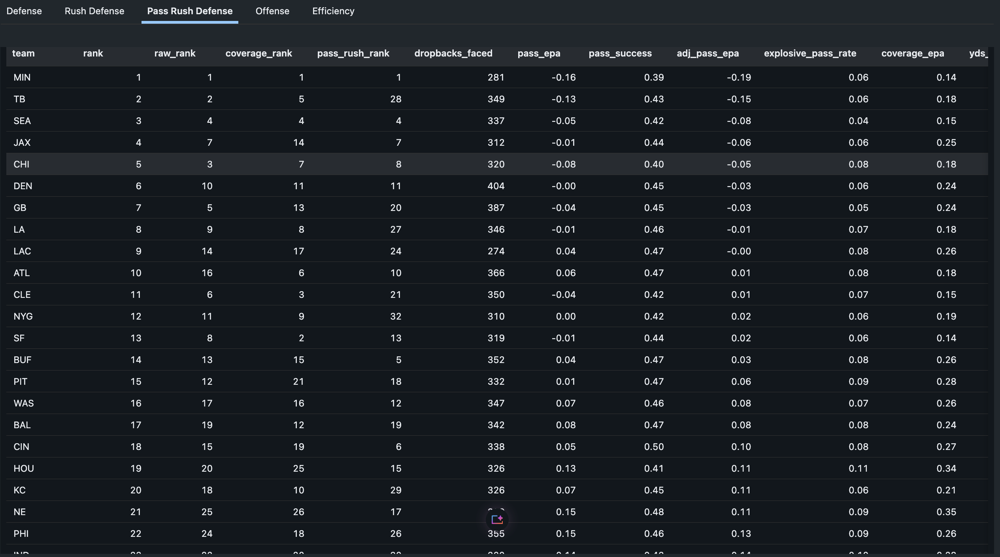
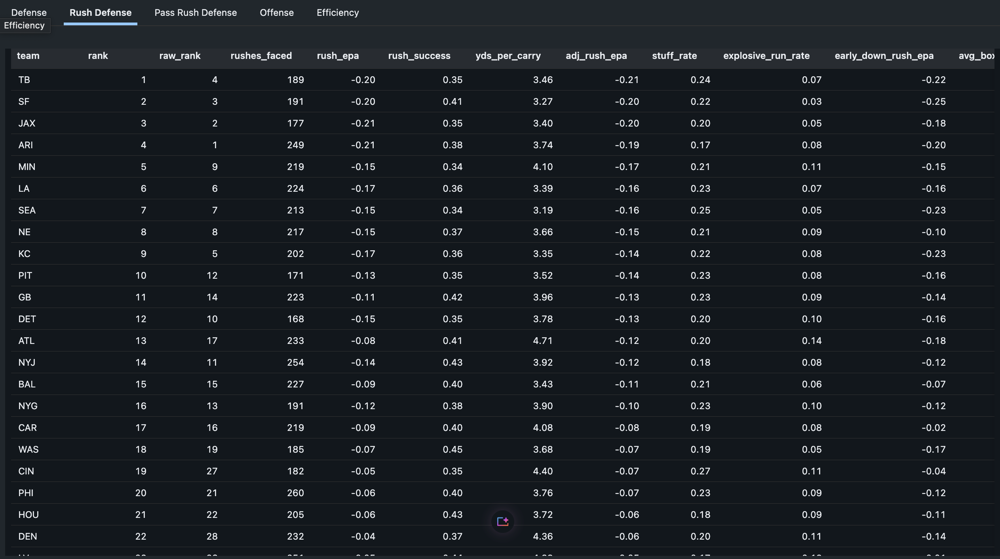
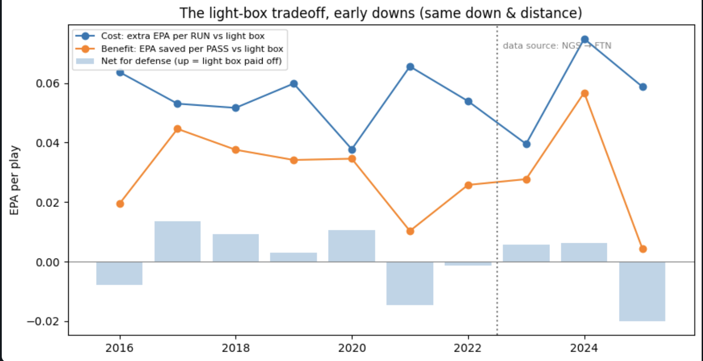
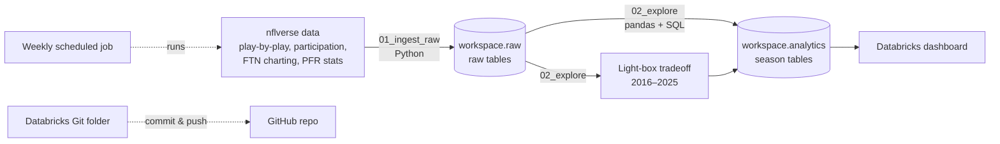

# NFL 2026 Season Analytics: A Live Pipeline and a Research Question

A season-long analytics project, built and run live during the 2026 NFL season. It has two parts:

1. **A live season tracker.** An automated Databricks pipeline pulls fresh data every week and ranks all 32 offenses and defenses three ways: what happened, how good each team really is, and what to expect going forward. It has been running weekly since September 2026, and the rankings, methods, and findings have evolved as the season played out.
2. **A research question.** *Did NFL defenses make the right call going lighter?* Using 10 seasons of play-by-play and box-count data (2016–2025), it measures what a light box costs against the run and what it buys against the pass.



Headline finding: light boxes are punished on the ground every season, but they also save EPA against the pass, and since offenses throw about two-thirds of the time against them, the tradeoff is roughly break-even. Going light wasn’t a mistake. It’s a balanced response to a pass-first league.

---

## Part 1: The 2026 season tracker

### What it tracks, every week

| Table | Contents |
|---|---|
| `def_rankings_2026` | Overall defense: three rankings, rank ranges, pass/rush ranks, pressure, blitz rate, early-down EPA, series conversion |
| `def_pass_2026` | Pass defense split into **pass rush** (pressure, sacks, blitz) and **coverage** (throw-only EPA, yards per target) |
| `def_rush_2026` | Rush defense: stuff rate, explosive runs, missed tackles, box counts, EPA vs. light boxes |
| `off_rankings_2026` | Offense: three rankings, adjusted pass/rush EPA, run rate, series conversion |
| `team_efficiency_2026` | Offense vs. defense efficiency for every team (scatter plot) |
| `team_games_2026` | One row per team per game, with 3-game rolling averages for trend charts |

| Overall defense | Offense |
|---|---|
|  |  |

| Pass defense | Rush defense |
|---|---|
|  |  |

**Full tables:** [Overall defense](results/def_rankings_2026.csv) · [Pass defense](results/def_pass_2026.csv) · [Rush defense](results/def_rush_2026.csv) · [Offense](results/off_rankings_2026.csv) · [Light-box tradeoff](results/light_box_tradeoff.csv)

### Three rankings, three questions

"Who's the best defense?" means different things, so every main table has three ranks:

| Column | Question it answers | How it's built |
|---|---|---|
| `raw_rank` | **What happened?** | Plain EPA per play on every play. Comparable to public sites like rbsdm.com. |
| `rank` | **How good are they really?** | Garbage time down-weighted, then adjusted for opponent strength. |
| `forecast_rank` | **What should we expect next?** | EPA + success rate, blended with last season as a prior. |

`rank_low`–`rank_high` give each team's likely rank range (10th–90th percentile), from resampling whole games 1,000 times.

### Season log

Notes recorded as the season unfolded. Each one shaped how the model works.

| When | What happened | What changed in the model |
|---|---|---|
| Week 4 | Minnesota led the league in pressure rate (about 42%), driven by blitzing on about 73% of dropbacks | Added blitz rate, average rushers, and EPA when not blitzing |
| Week 4 | Early opponent adjustments swung rankings wildly (Denver jumped from 24th to 5th on a few games) | Added shrinkage so a handful of games can't dominate a team's adjustment |
| Week 5 | Penalty plays like defensive pass interference were being dropped by the play filter (84 DPIs, about +1.76 EPA each) | Switched to the standard nflfastR play filter so penalties count |
| Week 6 | Atlanta looked bad in yards-allowed rankings but above average per play: it faced the 2nd-most dropbacks in the league | Split defense into separate pass and rush rankings; identified "funnel" defenses |
| Week 6 | Jacksonville's defense fell from 4th to 13th after one shootout vs. Houston, while its dominant win over Cleveland counted for only 11 plays | Added game-level rank ranges to show how uncertain each rank is |
| Week 7 | Detroit's offense ranked 3rd on all plays but 11th after removing garbage time (12th after opponent adjustment), since 30% of its plays came in lopsided games | Replaced the hard garbage-time cutoff with soft down-weighting (backtested, see below) |
| Week 7 | Rankings differed from SumerSports' public table | Traced most of the gap to penalty handling (rank agreement rose from 0.72 to 0.91 when matched); backtested both and kept penalties |
| Week 8 | Top defenses: MIN, TB, SEA. Top offenses: SF, BUF, KC | Added a prior-season forecast after backtesting showed it predicts better |

<!-- Keep adding a row each week or two as new storylines come up. -->

---

## Part 2: The research question

### The light-box tradeoff

A pass is worth far more than a run in the modern NFL (about +0.09 EPA vs. below zero). So defenses got lighter: nickel became the new "base," two-high safety shells spread, and fewer defenders stayed in the box. Offenses counterpunched by running against those lighter fronts, which helped revive the value of elite running backs.

**What does a light box (6 or fewer defenders) cost against the run, and what does it save against the pass?** Early downs, competitive games, comparing light and heavy boxes **within the same down and distance**:

| Season | Run cost (EPA per run) | Pass benefit (EPA saved per pass) | Pass rate vs. light box | Net for defense per snap |
|---|---|---|---|---|
| 2016 | +0.064 | 0.019 | 67% | +0.008 |
| 2017 | +0.053 | 0.045 | 68% | −0.014 |
| 2018 | +0.052 | 0.038 | 68% | −0.009 |
| 2019 | +0.060 | 0.034 | 67% | −0.003 |
| 2020 | +0.038 | 0.035 | 67% | −0.010 |
| 2021 | +0.066 | 0.010 | 67% | +0.014 |
| 2022 | +0.054 | 0.026 | 66% | +0.001 |
| 2023 | +0.040 | 0.028 | 67% | −0.006 |
| 2024 | +0.075 | 0.057 | 62% | −0.006 |
| 2025 | +0.059 | 0.004 | 61% | +0.020 |

*Negative net = the light box paid off for the defense.*



- **Light boxes are punished on the ground every season,** by +0.04 to +0.075 EPA per run.
- **They save EPA against the pass every season,** by up to 0.057 per pass.
- Because offenses pass about two-thirds of the time against light boxes, **the two effects roughly cancel out** (net between −0.014 and +0.020 per snap). That's the kind of balance game theory predicts when each side adjusts to the other.
- **Even against a light box, a run (about −0.07 EPA) is worth less than an average pass (about +0.10) on early downs.** So offenses can't simply punish light boxes by running more, which matches early-down run rates staying flat around 44% for a decade.

**What it means:** the "return of the run game" isn't a league-wide shift. Light boxes give up a small, real edge on the ground, and it pays off for offenses that can multiply it with an elite back, a strong line, or a running quarterback.

### Who wins the tradeoff in 2026

Using FTN box counts, which update during the season (early, small samples):
- **Defenses handling light boxes best so far:** Atlanta, Tampa Bay, Miami
- **Offenses punishing light boxes most on the ground:** Dallas, Atlanta, Detroit

### A data trap: the 2023 participation source change

Personnel and box-count data before 2023 comes from NFL Next Gen Stats, and from 2023 on it comes from FTN. Several "trends" jump right at that boundary:

| | 2022 | 2023 | 2024 | 2025 |
|---|---|---|---|---|
| Runs vs. light boxes | 39% | 44% | 58% | 55% |
| Base defense vs. 11 personnel (early downs) | 9% | 13% | 12% | 18% |

Early-down run rates stayed flat at about 44% the whole time. Shifts this sudden, timed exactly with a source change and with no matching offensive change, most likely reflect **different definitions between the two providers**, not a real change in how teams play. So this project avoids year-over-year personnel trend claims across 2023 and focuses on **within-season comparisons**, which a definition change can't distort.

### The answer

**Did NFL defenses make the right call going lighter? Yes, mostly.** Going light is roughly a break-even tradeoff, not a mistake.

- **The cost:** against a light box, offenses gain an extra **0.04–0.075 EPA per run**, in every season from 2016 to 2025.
- **The benefit:** light boxes save defenses up to **0.057 EPA per pass**, also in every season.
- **Why it evens out:** offenses throw about **two-thirds of the time** against light boxes, so the pass savings mostly cancel the run cost. The net effect per snap is close to zero (about −0.014 to +0.020).
- **Why defenses can afford it:** a light box isn't as light as it looks. Defenses fill it with **hybrid players**: big nickel packages with a third safety instead of a third cornerback, box safeties who tackle like linebackers, and faster linebackers who can cover running backs and tight ends. That keeps the run cost small while staying fast enough to defend the pass.
- **Why offenses can't just exploit it:** even against a light box, a run (about −0.06 EPA) is worth less than an average pass (about +0.09). Running more isn't a winning strategy for most teams, which is why early-down run rates stayed flat around 44% for a decade. Only elite run offenses, with a great back, strong line, or running quarterback, really cash in on the edge.

*The role of hybrid defenders is an interpretation. Box counts and personnel labels don't show who is in the box or how well they tackle and cover, so measuring hybrid defenders directly is a next step.*

---

## Pipeline



| Layer | What it does |
|---|---|
| **Ingest** (`01_ingest_raw`) | Pulls 10 nflverse datasets (2016–2026) with `nflreadpy` and saves them unchanged to `workspace.raw`. Each dataset uses its own valid season range. |
| **Transform** (`02_explore`) | Cleans plays, computes efficiency stats, opponent adjustments, forecasts, and uncertainty ranges, and saves the season tables to `workspace.analytics`. |
| **Research** (end of `02_explore`) | Historical personnel trends and the light-box tradeoff analysis, saving `light_box_tradeoff`, `light_box_by_defense`, and `light_box_by_offense`. |
| **Serve** | A Databricks dashboard reads the analytics tables, with team filters and week-by-week trend charts. |
| **Orchestration** | A Databricks job runs ingest → transform every week, after NFL stat corrections are published. |
| **Version control** | Notebooks live in a Databricks Git folder linked to this repo and are committed and pushed from Databricks. |

---

## Methodology

- **Play filter.** The standard nflfastR filter (`pass == 1 or rush == 1`), so penalty plays like defensive pass interference count. 2-point tries are excluded.
- **Garbage time is down-weighted, not removed.** Plays at 20–80% win probability count fully, and weight tapers to 30% in lopsided games. A hard cutoff threw away real information, like a team that leads big and keeps scoring.
- **Opponent adjustment.** Each game is compared to what that opponent *usually* does in its other games (leave-one-out, so a team never adjusts against itself), with shrinkage toward league average so a few early games can't swing the results.
- **Forecast prior.** Defense regresses to the mean more than offense, so the defensive forecast leans on last season longer.
- **Pass/rush split.** Pass defense is adjusted against passing offenses and rush defense against rushing offenses.

## Validation

Every modeling choice was backtested on **2018–2025**, judged by how well early-season numbers predict the rest of the season. Parameters were chosen with leave-one-season-out validation, so each season was tested on data the model never saw.

| Test | Result |
|---|---|
| Hard garbage-time cutoff vs. soft weighting vs. none | The hard cutoff predicted worst. Soft weighting and all plays were roughly tied, so soft weighting was kept, since it reduces garbage-time distortion without losing accuracy. |
| Adding a prior + success rate | Improved rest-of-season prediction in **6–7 of 8 seasons** for both offense and defense |
| Predicting rest-of-season **points** | Defense: 0.20 → 0.22 correlation. Offense: 0.49 → 0.51 with the forecast vs. current-season stats alone. |
| Excluding penalty plays (as SumerSports appears to) | **No meaningful difference** (< 0.01), so penalties are kept for completeness |

**Takeaway:** offense is far more predictable than defense (r ≈ 0.5 vs. ≈ 0.2). Early-season defensive rankings are noisy, which is why the dashboard shows rank ranges instead of only exact ranks.

---

## Limitations

- Defensive stats are noisy early in the season. Treat ranks outside the top few as ranges, not exact positions.
- Participation (personnel) data for the current season is only released after the postseason.
- Pressure rate combines PFR charting with play-by-play dropbacks, so it's approximate.
- No special teams, so this ranks offenses and defenses, not complete teams.
- The light-box analysis measures the **direct** value of each play. It doesn't capture indirect effects, like running to set up play-action, and offenses sometimes change the play after seeing the box.
- Team-level light-box numbers for 2026 rest on roughly 40–90 plays per team, and don't control for down and distance the way the league-wide comparison does.

---

## Tech stack

**Python** (pandas, NumPy, matplotlib) · **SQL** · **Databricks** (Unity Catalog, Jobs, AI/BI Dashboards, Git folders) · **nflreadpy / nflverse** · **Git & GitHub**

## Repository structure

```
Notebooks/
  01_ingest_raw        # pulls nflverse data into workspace.raw
  02_explore           # 2026 rankings, forecasts, dashboard tables, personnel trends,
                       # and the research question (light-box tradeoff)
results/               # CSV copies of the finished tables
Efficiency.png, Defense.png, Offense.png,
Pass_Rush_Defense.png, Rush_Defense.png, Light_Box.png
README.md
```

## Roadmap

- [x] Weekly automated pipeline and dashboard for the 2026 season
- [x] Opponent adjustment, soft garbage-time weighting, and prior-season forecast, all backtested
- [x] Light-box tradeoff: run cost vs. pass benefit, 2016–2025
- [ ] Move transformations into **dbt** models with tests and documentation
- [ ] Add dbt to the weekly job (ingest → dbt → dashboard)
- [ ] Is the light-box edge bigger for elite run offenses and mobile quarterbacks?
- [ ] Do light boxes cost more against two-high vs. one-high safety shells?
- [ ] End-of-season review: how well did the week-8 forecast predict final rankings?

## Data

All data comes from the open-source [nflverse](https://github.com/nflverse) project via [`nflreadpy`](https://github.com/nflverse/nflreadpy), including nflfastR play-by-play and EPA, FTN charting, and Pro Football Reference advanced stats. **Charting data provided by FTN Data via nflverse.** Data belongs to its respective owners and is used here for non-commercial analysis.

---

*Built by Cole Williams, Industrial & Systems Engineering, University of Southern California.*
